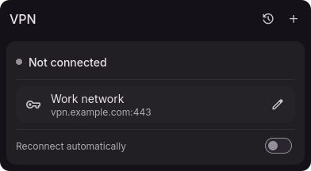
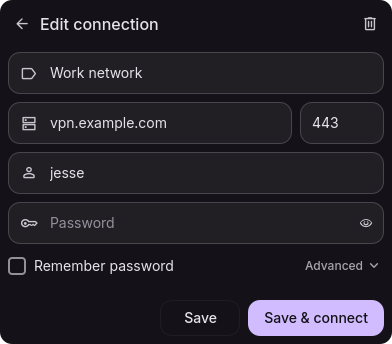

# Forti Bar

Fortinet SSL VPN controls in the [DankMaterialShell](https://github.com/AvengeMedia/DankMaterialShell)
top bar. Click the key icon next to the system tray to manage connections, connect
and disconnect. There's no separate app window. Under the hood it uses `openfortivpn`.

<p>
  
  
</p>

## Install

### Bazzite / Fedora Atomic

```sh
python3 scripts/build-rpm.py
sudo rpm-ostree install ./dist/noarch/forti-bar-*.noarch.rpm
systemctl reboot
```

After rebooting, run this once as your normal user to add the icon to your bar:

```sh
forti-bar
```

To upgrade later, rebuild and replace the layered package:

```sh
sudo rpm-ostree uninstall forti-bar --install ./dist/noarch/forti-bar-<version>.noarch.rpm
```

### Other distributions

Install `openfortivpn`, `ppp`, `python3-pyside6`, `libsecret`, `polkit` and
`systemd-resolved`, then:

```sh
sudo ./scripts/install.sh
forti-bar
```

### If the icon doesn't appear

If `forti-bar` reports `PLUGIN_NOT_FOUND`, DMS hasn't picked up the plugin yet:

```sh
forti-bar --restart-dms
```

## Usage

- **+** adds a connection; the pencil icon edits one.
- Click a connection to connect; click it again to disconnect.
- Passwords can be saved in your desktop keyring.
- Untrusted server certificates show their fingerprint before you accept them.
- **Reconnect automatically** retries after network loss or resume.
- The history icon shows recent connection events.

Supports username/password SSL VPN only. No OTP, SAML or IPsec. FortiOS 7.6.3+
removed SSL VPN tunnel mode, so gateways moved to IPsec won't work.

## How it works

- The DMS widget runs a small controller as your user; nothing in the bar runs as root.
- Connecting asks polkit for admin rights to run one helper,
  `/usr/libexec/forti-bar-helper`, which starts `openfortivpn`.
- Passwords are passed over stdin. They never appear in command arguments or DMS settings.
- The package installs the widget to `/etc/xdg/quickshell/dms-plugins/FortiBar`.
  `forti-bar` only enables it in your DMS settings and backs those files up first
  (`*.before-forti-bar`).

## Development

```sh
uv sync --locked
./forti-bar                       # run the widget from this checkout
uv run python -m unittest discover -s tests
uv run python -m fortibar --demo --screenshot=/tmp/menu.png          # offscreen preview
uv run python -m fortibar --demo --page=edit --screenshot=/tmp/edit.png
```

Running from the checkout copies the widget into
`~/.config/DankMaterialShell/plugins/FortiBar`, which takes priority over the
installed one. Running the installed `forti-bar` again removes that copy.
